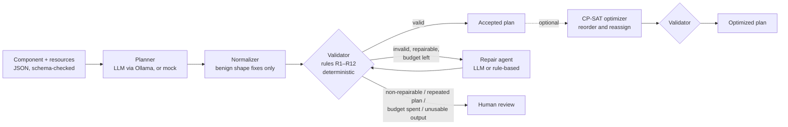

# Self-Correcting Manufacturing Process Agent (SCMPA)

A research prototype in which an AI system proposes a CNC process plan for a simplified component, checks it against explicit manufacturing constraints, diagnoses violations, repairs the plan and revalidates it. The loop ends when the plan is feasible under the declared rule set or needs a human to review it.

> **Safety and scope disclaimer.** SCMPA is a decision-support research prototype. It does **not** produce machine-executable G-code. No plan it outputs is claimed to be safe, collision-free, production-ready or suitable for execution on a real machine. The rule set is a deliberately simplified, documented model; see [`docs/assumptions_and_limits.md`](docs/assumptions_and_limits.md). All data in this repository is currently **synthetic**.

## Research question

> Can a constraint-guided agentic workflow improve the feasibility and completeness of generated manufacturing process plans compared with an LLM-only baseline?

The contribution is the closed loop **generate → validate → diagnose → repair → revalidate**. An LLM proposes and revises plans. Deterministic, unit-tested Python rules decide whether each plan satisfies the hard constraints. The LLM can never override them.

Hypotheses (to be tested, not assumed):

- **H1** Constraint feedback lowers the hard-violation rate compared with an LLM-only baseline.
- **H2** A bounded repair loop converts a measurable share of invalid plans into valid ones.
- **H3** A deterministic sequencing optimizer improves declared quality metrics without breaking hard constraints.
- **H4** Structured violation reports and repair histories make decisions easier to audit than free text.

## How it works



The validator alone decides validity. Every repaired or optimized plan is checked again, and every candidate, finding and repair is recorded in a run record.

## Results at a glance

Test split of the synthetic benchmark: 16 parts × 3 seeds, 3 parts infeasible by design. Details, caveats and the validator flaws found along the way are in [`docs/results.md`](docs/results.md); worked traces are in [`docs/examples.md`](docs/examples.md).

| | gemma3:4b | qwen3.5:9b |
|---|---|---|
| LLM alone: invalid plans (B0) | 79% | 54% |
| With validator: invalid plans accepted (B1) | 0% | 0% |
| With repair loop: correct outcome (B2) | 56% | 100% |
| Injected faults repaired (B2, corruption track) | 62–74% | 97% |
| Repair notes claiming changes that were not made | 20% of calls | 2% of calls |
| Optimizer: machine + tool change cost (B3), median cut | 42% | 48% |

- **H1:** supported. Detection alone removes every invalid plan from the accepted output.
- **H2:** supported, and strongly model-dependent.
- **H3:** supported for the declared metric (change counts, not time). The optimizer never broke a hard constraint in 5,216 runs. On benchmark v2, 17 of 137 LLM plans have a genuine machine/tool trade-off when assignments are fixed, and the weights steer the result as intended.
- **H4:** supported. The computed diff exposed every false repair claim.

All data is synthetic, so these numbers describe software behaviour on a toy benchmark, not industrial performance.

## Status

| Milestone | Content | Status |
|---|---|---|
| M0 | Repository, Pydantic schemas, example data, input validation | ✅ done |
| M1 | Deterministic validator (rules R1–R12) with unit tests | ✅ done |
| M2 | Planner interface, Ollama adapter, mock planner | ✅ done |
| M3 | Bounded generate–validate–repair loop | ✅ done |
| M4 | Synthetic benchmark, baselines B0/B1/B2, metrics, reports | ✅ done (gemma3:4b and qwen3.5:9b test runs, see `docs/results.md`) |
| M5 | Streamlit demo | ✅ done |
| M6 | Optional: OR-Tools sequencing (B3, H3) | ✅ done |
| M6 | Optional: FabriCAD investigation and importer (derived data, not redistributed) | ✅ done, see `docs/fabricad.md` |
| M6 | Optional: FreeCAD feature extraction from STEP geometry | ✅ done, see `docs/cad_extraction.md` |

## Quick start

Requires Python ≥ 3.11.

```bash
python -m venv .venv
# Windows: .venv\Scripts\activate    macOS/Linux: source .venv/bin/activate
pip install -e ".[dev]"
pytest
```

Load and check an example component:

```python
from scmpa.io import load_component, load_plan, EXAMPLE_COMPONENTS_DIR, REFERENCE_PLANS_DIR

component = load_component(EXAMPLE_COMPONENTS_DIR / "demo_bracket_001.json")
plan = load_plan(REFERENCE_PLANS_DIR / "demo_bracket_001_ref.json")

from scmpa.io import load_catalogue
from scmpa.validation import validate_plan

result = validate_plan(plan, component, load_catalogue())
print(result.valid, result.hard_constraint_violations, result.coverage)
```

The validator runs offline with no LLM. See [`docs/constraint_catalogue.md`](docs/constraint_catalogue.md) for rules R1–R12, their semantics and configuration.

### Generating plans

```python
from scmpa.planning import make_planner

planner = make_planner("mock")      # deterministic, offline, no API key
# planner = make_planner("ollama")  # local LLM via Ollama (default model qwen3.5:9b)
result = planner.generate_plan(component, load_catalogue())
result.status    # "ok" (schema-valid plan) or "failed" (controlled failure, with result.error)
result.plan      # ProcessPlan, still to be validated
result.attempts  # raw model outputs, issues, latency and token counts per call
```

The rest of the code talks to models only through `LLMClient` (`src/scmpa/llm/base.py`). Ollama is the first adapter, and adding another provider means writing one more adapter class.

**Ollama setup:** install Ollama, then run `ollama pull qwen3.5:9b` (or set `SCMPA_LLM_MODEL` to any local model). `OLLAMA_BASE_URL` defaults to `http://localhost:11434`. Sampling defaults to `temperature=0` and `seed=0` for repeatability. The live smoke test is opt-in: `SCMPA_TEST_OLLAMA=1 pytest tests/integration`.

Planner behaviour:
- **Prompts** are versioned files in `src/scmpa/prompt_templates/`. Every result records each prompt's name, version and content hash.
- **Model output** is constrained by a JSON schema where the provider supports it. It is then normalized and schema-checked before use; see `planning/normalize.py` for the narrow list of changes the normalizer is allowed to make.
- **Retries** happen only on schema or parse failures, and the retry message never includes validator findings. The plain LLM planner therefore stays a true "LLM-only" baseline.
- **`status="ok"` means well-formed, not feasible.** Feasibility is decided only by the validator.
- **Mock planner:** it builds the obvious plan from the component data. With `MockPlanner(faults=[...], seed=...)` it injects known faults, each with an expected detecting rule (`planning/faults.py`).

### Running the self-correcting loop

```bash
python scripts/run_demo.py                                    # mock planner + rule-based repair, offline
python scripts/run_demo.py --component demo_plate_002 --faults incompatible_tool swap_precedence missing_operation --seed 2
python scripts/run_demo.py --component demo_plate_002 --faults incompatible_tool --repair ollama   # LLM repair
python scripts/run_demo.py --planner ollama --repair ollama   # LLM for both steps
```

The script prints each iteration's plan, its violations and the repair changes, and saves the full run record to `reports/runs/`. In code:

```python
from scmpa.workflow import solve, save_run
from scmpa.repair import make_repair_agent

record = solve(component, catalogue, planner, make_repair_agent("rule_based"), max_repairs=3)
record.final_status   # "ACCEPTED" or "NEEDS_HUMAN_REVIEW"
record.stop_reason    # valid | max_repairs_reached | repeated_plan | non_repairable_violation |
                      # repair_agent_requested_review | planner_output_invalid | repair_output_invalid
```

How the loop stops:
- It makes at most `max_repairs` repair calls (default 3, or `SCMPA_MAX_REPAIRS`).
- It stops early if a repair repeats an earlier plan. Plans are compared by a hash of their operations and precedence, ignoring wording.
- It goes straight to human review, without spending repair attempts, when any violation is marked `repairable: false`.

`RuleBasedRepairAgent` is a deterministic, offline reference that fixes each violation from its evidence. It is **not** an AI result. See [`docs/architecture.md`](docs/architecture.md) for the components and authority boundaries.

### Demo UI

```bash
pip install -e ".[app]"
streamlit run src/scmpa/app/streamlit_app.py
```

- **Run the workflow:** pick a part (an example, a benchmark part or an uploaded JSON file), choose the planner (mock or Ollama), optionally inject faults, and choose the repair agent. The app shows:
  - the input part: features, machines, tools, ordering assumptions and stated assumptions;
  - an iteration timeline;
  - for each iteration, the plan, the validator findings with repair hints, and what the repair changed;
  - the final plan, with downloads of the plan and the full run log as JSON.
- **Inspect a saved run:** browse any saved run record, including slow LLM runs from experiments, without re-running them.
- **Experiment results:** summary tables, the chart, and filterable per-case results.

### Evaluation

```bash
pip install -e ".[dev,eval]"
python -m scmpa.evaluation.run_experiments --config configs/experiments/pilot_mock.json   # seconds, no LLM
python -m scmpa.evaluation.run_experiments --config configs/experiments/llm_test_full_gemma3-4b.json # main LLM experiment (gemma3:4b); resumable
```

The runner compares B0 (LLM only), B1 (+ validator), B2 (+ LLM repair loop) and R (rule-based reference) on the **same** initial plans. It does this on two tracks: generation, and repair of injected faults. Results go to `reports/experiments/<id>/`: raw per-case CSV/JSONL, `summary.md`, a chart, and every run record. See [`docs/evaluation.md`](docs/evaluation.md) for the method and [`docs/DATA_CARD.md`](docs/DATA_CARD.md) for the synthetic benchmark (24 components, 20% deliberately infeasible, split by component into dev and test).

### Sequence optimization (M6)

```bash
pip install -e ".[opt]"
python -m scmpa.evaluation.optimize_results reports/experiments/llm_test_full_qwen3.5-9b   # B3: optimize every accepted plan
```

`scmpa.optimization.optimize_sequence` takes a *valid* plan and uses OR-Tools CP-SAT to reorder its operations, optionally also reassigning eligible machine/tool pairs. It minimises `10 × machine changes + 1 × tool changes` subject to the declared precedence and resource eligibility, and the validator re-checks the result. It refuses invalid plans, because optimization is not repair. Total duration is fixed, so no time saving is claimed. The demo UI offers the same step on an accepted plan.

### Running on a Slurm GPU cluster

`scripts/hpc/slurm_experiment.sh` starts Ollama from an Apptainer image on a GPU node, downloads the models named in the config, and runs the experiment. Submit it from the repo root:

```bash
apptainer pull ~/ollama.sif docker://ollama/ollama:latest      # once, on a login node
mkdir -p logs
CONFIG=configs/experiments/llm_pilot_dev_gemma3-4b.json LIMIT=2 sbatch scripts/hpc/slurm_experiment.sh   # smoke run
sbatch scripts/hpc/slurm_experiment.sh                          # main run (llm_test_full_gemma3-4b)
CONFIG=configs/experiments/llm_test_full_gemma3-4b_v1.2.json sbatch scripts/hpc/slurm_experiment.sh   # v1.2 re-run on the same plans
```

Results so far, including two validator flaws found on the test split and fixed in rule set v1.2, are in [`docs/results.md`](docs/results.md).

The job is resumable: if it hits its time limit, resubmit the same command. The script header lists every override (`CONFIG`, `LIMIT`, `FRESH`, `VENV`, `PY_MODULE`, ...). It needs Python 3.11 or newer on the cluster.

If the input is invalid, `load_component` raises `InputValidationError`, which lists every problem and where it is:

```
Invalid input (demo.json): 2 problem(s)
  - features[2] (F3): unknown feature type 'dovetail'; known: [...]
  - resources.tools[0] (T1): unknown tool type 'boring_bar'; known: [...]
```

## Data model

All data is versioned JSON validated by Pydantic models in `src/scmpa/schemas/`. Unknown fields are rejected.

| File | Schema | Purpose |
|---|---|---|
| `data/catalogue/catalogue_v1.json` | `Catalogue` | Allowed operation, tool and feature types; tool-compatibility map; operations suitable for each feature type |
| `data/examples/components/*.json` | `Component` | Features, machines, tools, component-specific precedence assumptions, provenance |
| `data/examples/reference_plans/*.json` | `ProcessPlan` | Illustrative valid plans (not expert-reviewed) |
| — | `ValidationResult` | Validator output: hard violations, warnings, coverage |

Checks happen at two stages:

- **On input**, the component file is checked for schema conformance and against the catalogue. Unknown feature, tool or operation types, duplicate IDs, dangling references and cyclic precedence are rejected here.
- **On plans**, the schema only enforces structure. Unknown machine, tool or feature IDs in a plan, invalid operation types, bad durations and order violations are reported by the validator (rules R1–R12) as structured violations that can be repaired, not as parse errors.

## Repository layout

```
data/            catalogue, examples, synthetic/benchmark_v1 (all synthetic)
configs/         experiment configs
docs/            architecture, assumptions/limits, constraint catalogue, evaluation, results, examples, FabriCAD, CAD extraction, data card
src/scmpa/       schemas/, io.py, validation/ (R1–R12), llm/, planning/, repair/, workflow/, optimization/, importers/, cad/, evaluation/, app/, prompt_templates/
scripts/         run_demo.py, make_synthetic_data.py, make_examples.py, hpc/slurm_experiment.sh, freecad/ (fixture builder, FabriCAD evaluation)
tests/           unit/ and integration/ tests
reports/         generated experiment output (git-ignored)
```

## License

MIT. See [LICENSE](LICENSE).
