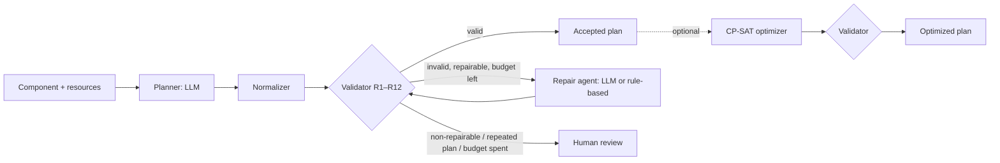

# Self-Correcting Manufacturing Process Agent: final report

**Suraj Balaji Rautrao** · OVGU Magdeburg, Digital Engineering · November 2026 · draft 1

> All data in this project is synthetic. The numbers below describe software behaviour on a toy benchmark under a declared, simplified rule set, not industrial performance. SCMPA produces no machine-executable output, and no plan it outputs is claimed to be safe or production-ready.

## Abstract

Large language models can write plausible CNC process plans, but plausibility is not feasibility: a plan may use a tool that cannot do the job, skip an operation or violate an ordering constraint. SCMPA tests whether a closed loop of **generate → validate → diagnose → repair → revalidate** makes LLM-generated process plans more reliable. A deterministic validator (12 rules) alone decides validity; an LLM proposes plans and repairs them from the validator's structured findings; a CP-SAT optimizer then reduces machine and tool changes in accepted plans without breaking any hard constraint.

On two synthetic benchmarks and three local models (gemma3:4b, qwen3.5:9b, gemma3:27b), the validator removed every invalid plan from the accepted output in every run, where the LLM alone produced invalid plans in 38–83% of cases. The repair loop's value depends strongly on the model: on injected faults it repaired 51–74% of cases with gemma3:4b and 92–97% with the two larger models, and on the harder benchmark gemma3:27b ended with a correct outcome in 47 of 48 cases. A model-size comparison within the gemma family shows that the small model's weakness is mainly size, not family. The optimizer cut the change cost of accepted plans by a median of 42–70% in 6,776 runs, none of which broke a hard constraint. The structured repair history exposed false repair claims that a reader of the model's text would have accepted: gemma3:4b claimed changes it had not made in 20% of repair calls. Along the way, the evaluation found and fixed two validator flaws and documented a class of false failures, which is part of the result.

## 1. Research question and hypotheses

> Can a constraint-guided agentic workflow improve the feasibility and completeness of generated manufacturing process plans compared with an LLM-only baseline?

| | Hypothesis | Measured by |
|---|---|---|
| H1 | Constraint feedback lowers the hard-violation rate compared with an LLM-only baseline. | Hard-violation rate and invalid plans accepted, B0 vs B1/B2 |
| H2 | A bounded repair loop converts a measurable share of invalid plans into valid ones. | Repair success, paired B1 vs B2 |
| H3 | A deterministic sequencing optimizer improves declared quality metrics without breaking hard constraints. | Machine and tool changes before and after; validity after |
| H4 | Structured violation reports and repair histories make decisions easier to audit than free text. | Agreement between the model's change notes and the computed plan diff |

No numerical targets were set in advance. Only measured results are reported, including negative ones.

## 2. System



**Data model.** A component is a list of typed features (holes, threaded and reamed holes, pockets, slots, contours, chamfers, faces) with optional dimensions, plus the machines and tools available for it and component-specific precedence constraints, each with a rationale. A shared catalogue maps feature types to suitable operations and operations to compatible tool types. All inputs are strict Pydantic schemas, so malformed input fails before planning (`docs/architecture.md`).

**Planner.** An LLM served locally through Ollama receives the component and a model view of the catalogue and returns a JSON process plan: an ordered list of operations, each with a type, target features, machine, tool and duration estimate, plus optional precedence edges. Schema errors are retried; a normalizer fixes only benign shape problems.

**Validator.** Twelve deterministic rules (`docs/constraint_catalogue.md`) check operation types, machine existence and capability, tool existence and compatibility, feature coverage, feature references, precedence validity and order, durations and completeness. A plan is valid if and only if no rule reports a hard violation. Each violation carries evidence, a repair hint and a `repairable` flag: a violation that no change with the available resources can fix is marked non-repairable, and the case goes to human review without spending repair attempts. The LLM never decides validity.

**Repair loop.** The repair agent receives the plan and the violation list and returns a revised plan with change notes. The loop stops when the plan is valid, a violation is non-repairable, the repair agent returns a plan it already produced, its output is unusable, or 3 repairs are spent. When a run ends in human review, the reviewer gets the candidate with the fewest hard violations. A deterministic rule-based repair agent (R) runs the same loop as a non-AI reference point.

**Optimizer.** A CP-SAT model (OR-Tools) reorders a valid plan, and optionally reassigns each operation to another eligible machine/tool pair, to minimise `10 × machine changes + 1 × tool changes` between consecutive operations, subject to all declared precedence. It solves in two phases (cost, then minimal displacement), with deterministic time limits, one worker and a fixed seed, so results are repeatable. The output is checked again by the validator.

**CAD and external data (extensions).** `scmpa.cad` extracts holes, pockets, slots and steps from STEP geometry with FreeCAD, and `scmpa.importers.fabricad` reads the text labels of the FabriCAD dataset. Both produce components marked as derived data (Section 4.7).

## 3. Experimental setup

**Benchmarks.** Both are generated deterministically and committed; a unit test regenerates them byte for byte.

| | Benchmark v1 | Benchmark v2 |
|---|---|---|
| Components | 24 (19 feasible, 5 infeasible by design) | 24 (19 feasible, 5 infeasible) |
| Features per part | datum face + 3–7 | 6–10 |
| Machines | 1–3, broad capabilities | specialised machines with partial overlap |
| Precedence | sparse | denser (about 10 constraints) |
| Split | dev 8 / test 16 parts (3 infeasible) | same split sizes |

Infeasible parts lack every capable machine or every compatible tool for one required operation; the correct outcome for them is human review.

**Systems.** For each (component, seed) the planner runs once, and all systems start from that identical plan (paired design).

| ID | After the initial plan |
|---|---|
| B0 | Nothing: the plan is accepted unchecked |
| B1 | Validated; invalid plans go to human review |
| B2 | LLM repair loop, at most 3 repairs |
| B3 | B2 followed by the optimizer |
| R | Rule-based repair, same loop (reference, not an AI result) |

**Tracks.** *Generation*: the LLM plans from scratch (16 test parts × 3 seeds = 48 cases). *Corruption*: the reference plans of the 13 feasible test parts with 2 injected faults each, 39 cases. The corruption inputs are identical for every model, so this track measures repair independently of planning and allows paired comparisons across models.

**Models and settings.** gemma3:4b, qwen3.5:9b (thinking off) and gemma3:27b through Ollama, temperature 0.7, seeds 0–2, on a university Slurm GPU cluster. Prompts, rule set version, catalogue hash and benchmark manifest hash are recorded with every run, and a changed input under an existing experiment ID is refused.

**Statistics.** Rates are reported with 95% Wilson intervals. Paired comparisons use exact McNemar tests on discordant cases. Because outcomes are strongly correlated across seeds of the same part, the number of distinct components behind an effect is reported with every p-value; the effective sample size is closer to 16 parts than to 48 cases.

**Protocol.** Prompt and rule development used the dev split only. Two validator flaws were found on the test split (Section 4.2); the original run is kept as the primary record, and the fix is reported beside it.

## 4. Results

### 4.1 Benchmark v1: two models

| Test split, rule set v1.2 | gemma3:4b | qwen3.5:9b |
|---|---|---|
| B0: hard-violation rate (LLM alone) | 79% [66–88%] | 54% [40–67%] |
| B1: invalid plans accepted | 0% | 0% |
| B2: correct outcome (generation) | 56% (27/48) | 100% (48/48) |
| B2: invalid feasible plans repaired | 8 / 29 | 17 / 17 |
| B2: injected faults repaired (corruption) | 62–74% (two runs) | 97% (two runs, 76/78 pooled) |
| R: correct outcome (generation) | 100% | 100% |

- **Detection is the main safety gain.** With either model, validation alone takes invalid plans accepted to zero and routes all 9 infeasible cases to human review.
- **Repair depends on the model.** gemma3:4b repairs consistently but on few parts: B2 beats B1 by 8 to 0 (p = 0.008), but all wins come from 3 components. qwen3.5:9b matches the rule-based ceiling on every generation case and wins 17 to 0 against B1 (8 components, p < 0.001).
- **gemma3:4b's main error is coverage:** it often gives a hole only a spot drill, or leaves features without an operation. qwen's errors are mostly wrong tool or machine, which are easier to repair.
- On the paired corruption inputs, qwen repaired 10–15 cases that gemma3:4b did not, and gemma 1 that qwen did not (p ≤ 0.012).

### 4.2 Validator flaws found by the evaluation

Two flaws in rule set v1.1 were found by inspecting run records of the first full run:

1. **Spot drilling counted as making a hole.** Plans with a hole that was only spot drilled passed (8 false passes), and in 9 feasible cases an unavailable spot-drilling step made the case non-repairable (false escalations).
2. **Removability ignored still-required steps.** An operation was called removable if removing it uncovered no currently covered feature, so a required tapping step on an undrilled hole could be "removed".

Rule set v1.2 adds a catalogue notion of *preparatory* operations (spot drilling contributes to a hole but never completes it) and compares each target feature's missing operation types before and after a removal. Re-scoring the same plans without new LLM calls raised R's correct outcome from 81% to 100% and its human-review precision from 50% to 100%; on the dev split nothing changed. The re-scoring infrastructure (`initial_plans_from`) replays cached plans exactly, so the effect of a rule change is measured on identical inputs.

### 4.3 Run-to-run noise

Repeating a repair run with identical inputs and prompts measures noise that seeds do not capture:

| Repeat with identical inputs | Outcomes that flipped |
|---|---|
| gemma3:4b, corruption track | 11 of 39 (p = 0.23, no systematic difference) |
| qwen3.5:9b, both tracks | 3 of 87 |

A single gemma3:4b repair run cannot resolve differences of about ±5 cases, so its corruption result is reported as a range (62–74%). qwen's results reproduce. The noise belongs to the weaker model, not to the loop.

### 4.4 Benchmark v2 and model size

Benchmark v2 makes planning harder through specialised machines, more features and denser precedence. gemma3:27b was added to separate model size from model family.

| Benchmark v2, test | gemma3:4b | qwen3.5:9b | gemma3:27b |
|---|---|---|---|
| B0: hard-violation rate | 83% (40/48) | 65% (31/48) | **38%** (18/48) |
| Feasible cases with a valid first plan | 8 / 39 | 17 / 39 | **30 / 39** |
| Mean hard violations per first plan (feasible) | 4.44 | 2.79 | **0.87** |
| Feature coverage of first plans | 0.75 | 0.97 | **1.00** |
| B2: correct outcome (generation) | 58% (28/48) | 94% (45/48) | **98%** (47/48) |
| B2: injected faults repaired | 51% (20/39) | **95%** (37/39) | 92% (36/39) |
| B2: stops on a repeated plan | 26 | 1 | 1 |
| Invalid plans accepted (B1, B2) | 0 | 0 | 0 |

- **The harder benchmark hurts every planner**, most visibly qwen, whose violations per plan nearly triple, almost all wrong-machine and wrong-tool errors, which is what the specialised machines were built to provoke.
- **Size fixes gemma's planner.** gemma3:27b leaves no feature uncovered (gemma3:4b: 127 coverage violations) and produces a valid first plan more often than qwen (15 to 2 on paired cases, p = 0.002).
- **Repair saturates earlier than planning.** On the paired corruption inputs, gemma3:27b and qwen differ in only 3 cases (p = 1.0); against gemma3:4b, gemma3:27b repairs 16 more and none fewer (p < 0.001).
- **The loop still adds value on top of the strongest planner.** For gemma3:27b, B2 beats B1 by 8 to 0 (4 components, p = 0.008). Within every model, B2 never lost a case to B1.
- **Precedence is the residual weakness.** Across models and benchmarks, the failures left after LLM repair are mostly ordering errors: an added operation is placed before the operations it depends on.

### 4.5 Sequence optimization (H3)

| Accepted plans, reorder + reassign, default weights | Plans | Valid after | Median change-cost reduction |
|---|---|---|---|
| Benchmark v1: gemma3:4b / qwen3.5:9b (generation) | 18 / 39 | all | 42% / 48% |
| Benchmark v1: corruption, both models | 62 | all | 56–64% |
| Benchmark v2: gemma3:4b / qwen3.5:9b / gemma3:27b (generation) | 19 / 36 / 38 | all | 47% / 64% / 67% |
| Benchmark v2: corruption, all models | 93 | all | 69–70% |

- **No hard constraint was broken in 6,776 optimizer runs** across all experiments, modes and weight settings; most were proven optimal, and the rest stopped at the deterministic time limit with a valid, improved plan.
- **LLM plans are complete but not change-aware.** Even gemma3:27b's valid plans start at 6.4 machine changes per plan and end at 1.7.
- **Weights matter only when assignments are fixed.** With reassignment, operations of one type can almost always share a machine, so grouping by machine also groups tools, and the weights rarely change the optimum (1 distinct plan out of all LLM plans). With each operation's machine and tool fixed, 23 of 241 accepted plans on benchmark v2 have a proven machine-versus-tool trade-off (none on benchmark v1), and the weights move the result in the intended direction. Only trade-offs proven optimal at every weight are counted; apparent ones caused by a time-limited solve are excluded.
- The metric is change counts, not time: durations are fixed estimates, and setups within a machine are not modelled.

### 4.6 Auditability and false failures (H4)

**False repair claims.** Comparing each repair agent's change notes with the computed diff of the plan it returned: gemma3:4b claimed changes but returned an unchanged plan in 24 of 121 repair calls (20%), qwen3.5:9b in 1 of 66. All were caught by repeated-plan detection and are visible in the diff (`docs/examples.md`, case 2).

**False failures** were audited by classifying every violation in the 96 initial generated plans of benchmark v1. Most violations are genuine. Five, in four plans, reject common shop practice that the catalogue does not model: a spot drill used to chamfer, a chamfered threaded-hole entry, and spot drilling or pre-drilling a pocket entry. Only one plan was rejected for this reason alone, and the cost was a needless repair edit, never a wrong routing to human review. Separately, 10 of qwen's 26 invalid plans fail only because an optional spot-drilling step had no spot drill available; excluding them, qwen's LLM-only invalid rate on benchmark v1 is 33% rather than 54%.

### 4.7 Extensions: CAD extraction and FabriCAD

- **FabriCAD importer.** FabriCAD (CC BY-NC 4.0, itself synthetic) labels features in German free text. The importer maps holes, threaded and fitted holes, pockets and slots, and omits and lists everything else; all 30 public preview samples import (166 features mapped, 117 omitted). Imported data stays in a git-ignored folder.
- **FreeCAD extractor.** Rules on B-rep geometry detect holes (concave full-circle cylinders, through or blind by probing), pockets, slots and steps (floors with a clear approach direction, classified by open sides). On a modelled test part it finds all 7 features with correct dimensions, and the resulting component runs through the workflow. On FabriCAD's 30 preview parts, against FabriCAD's own labels:

| Category | Recall | Precision |
|---|---|---|
| Holes | 96% | 92% (diameters: 107 of 114 matched) |
| Pockets | 88% | 64% |
| Slots | 68% | 94% |
| Steps | 93% | 57% |

  The rules were adjusted once on this data, so these are in-sample figures (`docs/cad_extraction.md`).

### 4.8 A negative result: prompt v2

A revised planner prompt (explicit treatment of preparatory operations, tool look-up and a self-check) was compared with the original on the dev split with gemma3:4b. Violations per plan fell from 2.29 to 1.75, but valid plans did not increase: 15 vs 14 invalid of 24, with 5 discordant cases in two parts moving in opposite directions (p = 1.0). The test-split run was therefore not made, and the original prompt stayed in use. The model-size result (Section 4.4) suggests that gemma3:4b's coverage gap is a capability limit that prompting does not fix.

## 5. Discussion

- **H1 is supported.** In every run, with every model and on both benchmarks, the validator removed all invalid plans from the accepted output and routed all infeasible parts to human review. This holds by construction for the declared rules; the evaluation's contribution is showing how often it matters: 38–83% of LLM-only plans were invalid.
- **H2 is supported, with the effect size set by the model.** The loop never made a correct validator-only outcome wrong, and with best-candidate selection no case ended worse than it started. How much it repairs ranges from 11 of 31 invalid feasible plans (gemma3:4b, benchmark v2) to all of them (qwen3.5:9b, benchmark v1). Planning quality improves with model size more than repair quality does: a 9b model already repairs near the ceiling, while planning kept improving up to 27b.
- **H3 is supported for the declared metric.** The optimizer cuts the change cost by about half to two thirds without ever breaking a constraint. Its weighting is only consequential when machine assignments are fixed, which is itself a finding about this problem structure.
- **H4 is supported with a concrete measure.** Free-text repair notes were wrong in a fifth of the small model's calls; the structured diff and stop reasons made every such case visible.
- **The validator is the component that needs the most care.** Two flaws and one false-failure class were found only by inspecting results. Separating the rule set version, re-scoring cached plans and reporting the original run alongside the fix kept these findings from contaminating the comparison.

## 6. Limitations and threats to validity

- **Synthetic data and a simplified rule set.** Geometry, tool size, setups, fixturing and cutting data are not modelled (`docs/assumptions_and_limits.md`). A "valid" plan is valid only under these rules; tool-diameter mismatch is a known false-pass class.
- **Reference plans are one valid plan among several** and were not reviewed by a manufacturing expert.
- **Small effective sample.** 16 test parts per benchmark, with outcomes correlated across seeds. Several effects rest on 3–8 components.
- **The benchmark designer also built the system.** Benchmark v2 was designed to provoke specific errors, and the catalogue reflects the author's own manufacturing assumptions.
- **Single runs for most configurations.** Noise was measured for two models only; gemma3:27b's results come from one run.
- **Latency is not comparable** across runs, because jobs ran on different cluster nodes.
- **The CAD figures are in-sample**, on 30 parts that were also used for one rule adjustment.

## 7. Future work

- **Rule set v1.3** with auxiliary operations (chamfering any hole edge, entry holes for pockets) to remove the documented false failures, decided on the dev split.
- **Precedence-aware repair:** give the repair agent the dependency order explicitly, since ordering is the residual failure of every model.
- **A held-out CAD evaluation** on the full FabriCAD release, and a combined importer that takes geometry from the STEP file and threads and fits from the text labels.
- **Expert review** of a sample of accepted plans to estimate the false-pass rate that the rule set cannot see.
- **Time-based optimization** once setups and tool-change times are modelled.

## 8. Reproducibility

```bash
pip install -e ".[dev,eval,opt]"
pytest                                                                     # 482 tests; FreeCAD and live-LLM tests skip if unavailable
python scripts/make_synthetic_data.py --force                              # regenerates benchmark v1 exactly
python -m scmpa.evaluation.run_experiments --config configs/experiments/pilot_mock.json   # full pipeline, no LLM, seconds
python -m scmpa.evaluation.report reports/experiments/<experiment_id>      # rebuild tables from stored results
python -m scmpa.evaluation.optimize_results reports/experiments/<experiment_id>
```

Every reported experiment has its config in `configs/experiments/` and its frozen inputs, cached plans, run records and tables in `reports/experiments/<experiment_id>/`. Cluster runs use `scripts/hpc/slurm_experiment.sh`. Detailed per-run analysis is in [`results.md`](results.md), and worked traces in [`examples.md`](examples.md).

## References

- M. Kruse, D. Böhnke, F. Heinze, J. Borowski. *FabriCAD: Large-Scale Synthetic Dataset for Automated Manufacturing Process Planning with a Transformer-based Baseline Framework CadToSeq.* Procedia CIRP (CIRP ICME 2026), in press. Data: CC BY-NC 4.0.
- Google OR-Tools, CP-SAT solver, version 9.15.
- FreeCAD 1.1.
- Ollama; models gemma3:4b, gemma3:27b (Google) and qwen3.5:9b (Alibaba Qwen).

## Appendix: experiment index

| Section | Experiment ID |
|---|---|
| 4.1, 4.2 | `llm_test_full_gemma3-4b` (v1.1), `rescore_test_gemma3-4b_v1.2`, `llm_test_full_gemma3-4b_v1.2`, `llm_test_full_qwen3.5-9b` |
| 4.3 | `llm_test_full_qwen3.5-9b_rep2` |
| 4.4 | `llm_test_full_gemma3-4b_bench-v2`, `llm_test_full_qwen3.5-9b_bench-v2`, `llm_test_full_gemma3-27b_bench-v2` |
| 4.5 | `optimization.md` in each of the above |
| 4.8 | `dev_gemma3-4b_prompt-v1`, `dev_gemma3-4b_prompt-v2` |
